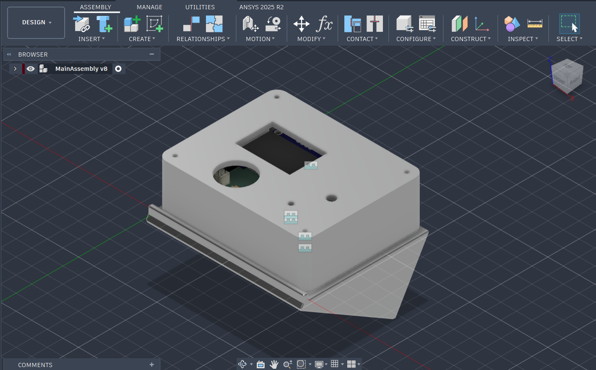

# Attendance Terminal

The attendance terminal is a compact, standalone barcode terminal for tracking school club attendance. 
Students scan their existing school ID card, and the terminal sends the scan over Wi-Fi to a backend server that records attendance.

I built this project to participate in [Hack Club's Half-Life YSWS](https://halflife.hackclub.com)

## Description
________________________________

The attendance terminal is there to solve a big issue at my school. Most clubs and teams at our school track attendance, either for how long you have been there 
or just to make sure you attend. However, there is no centralized way to do attendance. Some do it on paper, some have their own system, but it is overall very uncoordinated.
This project aims to fix that by having an unified hardware scanner module for every club. Then, on a seperate web-app (not currently included) a student would link their information to their student card number, which exists in the form of a barcode on their student card. Then the student can choose to scan their student card, or the qr code
generated on the web-app to sign in. For each club, there would be an admin portal where the club admin would input the external information the club wants. For example, if
there is a tutoring club, they would want to know whether you are a tutor or a student. So before signing in, the student would go into the club's portal on the web-app and fill
in any additional information the clubs want. The attendance information for each club is only shown to the club admin, so the student will have multiple attendance records for 
various clubs. 

## Features
________________________________
* 3D Printed Case
* RGB Status LED
* Buzzer for audio confirmation 
* OLED display for text
* Custom PCB
* Battery Powered
* Optional USB-C Wired connection while charging battery

## PCB
________________________________
Custom PCB Made in KiCad. Some footprints and schematics were from [marbastlib](https://github.com/ebastler/marbastlib). 

## CAD
________________________________
Custom 3D-Printable CAD for the case, which houses the project. It is in 3 parts, the base, which houses the battery, the power switch and has the holes for the usb-c cable connection. The lid which is what the PCB screws onto, has legs that extend out to allow the top of the pcb to have room for the components. It also has cutouts for the Display, Scanner module, LED and Buzzer. Lastly there is a stand that allows the whole box to sit at an angle to make it easier to scan.

## Firmware
________________________________
There is custom firmware written currently for scanning the barcode or qrcode and displaying the code on the screen, with an audible beep and status light confirmation status.
The current firmware is not in its final stage and does not include the wifi capabilites as I will need to build the backend and the web app it connects to first. The firmware can be found in the firmware folder, main.py

# Bill of Materials (BOM)
________________________________
Here is everything that you will need to make the attendance terminal: [Click here](https://docs.google.com/spreadsheets/d/1CIG54QZLjPgN8hb-R9MU0n-KgLEakrtmUqO80z-3FYI/edit?usp=sharing)

| Item                                              | Description     | Preowned | Of sets | Pcs set | Price set usd | Item total price tax shipping usd                                                                               | Supplier   | Url                                                                                                                                                                                                                                                                                                                                            |
| :------------------------------------------------ | :-------------- | :------- | :------ | :------ | :------------ | :-------------------------------------------------------------------------------------------------------------- | :--------- | :--------------------------------------------------------------------------------------------------------------------------------------------------------------------------------------------------------------------------------------------------------------------------------------------------------------------------------------------- |
| Megaboard PCB Printing with JLCPCB                | PCB             | FALSE    | 1       | 5       | $4.00         | $10.45                                                                                                          | JLCPCB     | https://github.com/anvaymathur/AttendanceTerminal/blob/main/Assets/PCBPrice.png                                                                                                                                                                                                                                                                |
| GM861S UART/USB QR Code Barcode Scanner Module    | Scanner         | FALSE    | 1       | 1       | $12.06        | $19.36                                                                                                          | Aliexpress | https://www.aliexpress.com/item/1005004625447564.html?spm=a2g0o.cart.0.0.406938daaYfxhp&mp=1&pdp_npi=6%40dis%21USD%21USD+12.70%21USD+12.06%21%21USD+12.06%21%21%21%402101d9ef17917595512443088e0fa2%2112000049687924342%21ct%21CA%218080657096%21%211%210%21                                                                                   |
| 2N7000 MOSFET Transistors                         | Transistor      | TRUE     | 1       | 50      | $3.25         | $3.25                                                                                                           | Aliexpress | https://www.aliexpress.com/item/1005010455877756.html?spm=a2g0o.cart.0.0.406938daaYfxhp&mp=1&pdp_npi=6%40dis%21USD%21USD+3.25%21USD+1.19%21%21USD+1.19%21%21%21%402101e5ab17917587327662497e0cf4%2112000052472892653%21ct%21CA%218080657096%21%211%210%21                                                                                      |
| Male Female Pin Header Single Row 2.54mm          | Header Pins     | TRUE     | 1       | 20      | $10.51        | $10.51                                                                                                          | Aliexpress | https://www.aliexpress.com/item/1005003642939564.html?spm=a2g0o.cart.0.0.406938daaYfxhp&mp=1&pdp_npi=6%40dis%21USD%21USD+10.51%21USD+10.51%21%21USD+10.51%21%21%21%402101e5ab17917588011244964e0cf4%2112000026620972925%21ct%21CA%218080657096%21%211%210%21&pdp_ext_f=%7B%22cart2PdpParams%22%3A%7B%22pdpBusinessMode%22%3A%22retail%22%7D%7D |
| Mini Vertical Micro Slide Switch                  | Power Switch    | TRUE     | 1       | 100     | $4.22         | $4.22                                                                                                           | Aliexpress | https://www.aliexpress.com/item/1005012254659077.html?spm=a2g0o.cart.0.0.406938daaYfxhp&mp=1&pdp_npi=6%40dis%21USD%21USD+8.45%21USD+4.22%21%21USD+4.22%21%21%21%4021033b3317917594057515630e0d76%2112000057879053223%21ct%21CA%218080657096%21%211%210%21                                                                                      |
| PH2.0 JST Male Female Plug Socket                 | Connectors      | TRUE     | 1       | 180     | $5.74         | $5.74                                                                                                           | Aliexpress | https://www.aliexpress.com/item/1005010504133815.html?spm=a2g0o.cart.0.0.406938daaYfxhp&mp=1&pdp_npi=6%40dis%21USD%21USD+11.96%21USD+5.74%21%21USD+5.74%21%21%21%402101d9ef17917595642223576e0fa2%2112000052613306875%21ct%21CA%218080657096%21%211%210%21                                                                                     |
| Aluminum Electrolytic Capacitor                   | Capcitor        | TRUE     | 1       | 40      | $3.01         | $3.01                                                                                                           | Aliexpress | https://www.aliexpress.com/item/1005011811368397.html?spm=a2g0o.cart.0.0.406938daaYfxhp&mp=1&pdp_npi=6%40dis%21USD%21USD+3.01%21USD+1.19%21%21USD+1.19%21%21%21%402101d9ef17917595512443088e0fa2%2112000056639843395%21ct%21CA%218080657096%21%211%210%21                                                                                      |
| Resistor Assortment Kit                           | Resistors       | TRUE     | 1       | 300     | $4.03         | $4.03                                                                                                           | Aliexpress | https://www.aliexpress.com/item/1005010779049132.html?spm=a2g0o.cart.0.0.406938daaYfxhp&mp=1&pdp_npi=6%40dis%21USD%21USD+8.23%21USD+1.19%21%21USD+1.19%21%21%21%402101d9ef17917595512443088e0fa2%2112000053480061365%21ct%21CA%218080657096%21%211%210%21                                                                                      |
| Diffused Cathode RGB LED                          | RGB LED         | TRUE     | 1       | 50      | $4.49         | $4.49                                                                                                           | Aliexpress | https://www.aliexpress.com/item/1005011597522333.html?spm=a2g0o.cart.0.0.406938daaYfxhp&mp=1&pdp_npi=6%40dis%21USD%21USD+8.98%21USD+4.49%21%21USD+4.49%21%21%21%402101d9ef17917598161385593e0fa2%2112000056017941722%21ct%21CA%218080657096%21%211%210%21                                                                                      |
| 3V Active Buzzer Magnetic                         | Buzzer          | TRUE     | 1       | 10      | $3.29         | $3.29                                                                                                           | Aliexpress | https://www.aliexpress.com/item/1005012105971644.html?spm=a2g0o.cart.0.0.406938daaYfxhp&mp=1&pdp_npi=6%40dis%21USD%21USD+6.58%21USD+3.29%21%21USD+3.29%21%21%21%402101d9ef17917598354986444e0fa2%2112000057527255015%21ct%21CA%218080657096%21%211%210%21                                                                                      |
|  IIC OLED Display Module                          | OLED Screen     | TRUE     | 1       | 1       | $3.34         | $3.34                                                                                                           | Aliexpress | https://www.aliexpress.com/item/1005008934254841.html?spm=a2g0o.cart.0.0.406938daaYfxhp&mp=1&pdp_npi=6%40dis%21USD%21USD+3.34%21USD+1.19%21%21USD+1.19%21%21%21%402101d9ef17917595512443088e0fa2%2112000047263287878%21ct%21CA%218080657096%21%211%210%21                                                                                      |
| seeed XIAO ESP32-S3 Mini Development Board Module | Microcontroller | TRUE     | 1       | 1       | $16.90        | $16.90                                                                                                          | Aliexpress | https://www.aliexpress.com/item/1005008813495235.html?spm=a2g0o.cart.0.0.406938daaYfxhp&mp=1&pdp_npi=6%40dis%21USD%21USD+36.74%21USD+16.90%21%21USD+16.90%21%21%21%402101d9ef17917600600567357e0fa2%2112000046840040809%21ct%21CA%218080657096%21%211%210%21                                                                                   |
|  3.7V 110mAh 301230 JST PH 2.0mm LiPo Battery     | Battery         | TRUE     | 1       | 2       | $10.94        | $10.94                                                                                                          | Aliexpress | https://www.aliexpress.com/item/1005010595321382.html?spm=a2g0o.cart.0.0.1f2038daooOQB6&mp=1&pdp_npi=6%40dis%21USD%21USD+11.89%21USD+10.94%21%21USD+10.94%21%21%21%402101d9ef17917603080878977e0fa2%2112000052929761860%21ct%21CA%218080657096%21%211%210%21                                                                                   |
| Grand Total:                                      |                 |          |         |         | $85.78        |  |            |                                                                                                                                                                                                                                                                                                                                                |
|                                                   |                 |          |         |         |               |                                                                                                                 |            |                                                                                                                                                                                                                                                                                                                                                |

# Thank you
