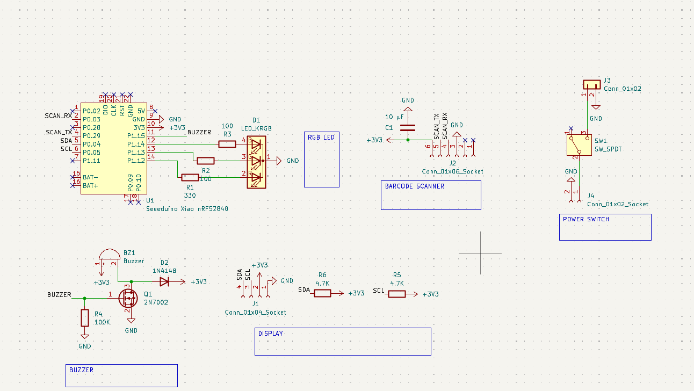
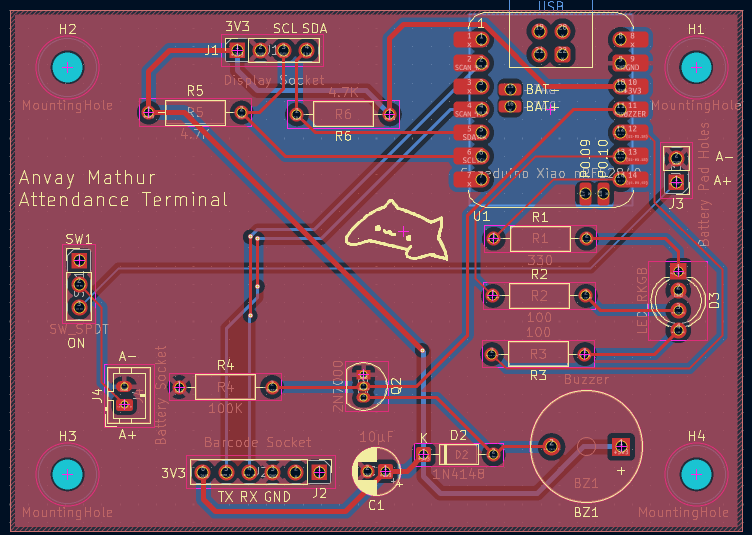
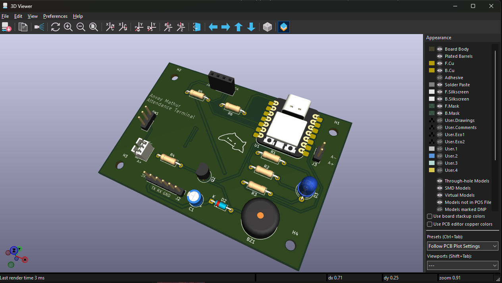

# Attendance Terminal

The attendance terminal is a compact, standalone barcode terminal for tracking school club attendance. 
Students scan their existing school ID card, and the terminal sends the scan over Wi-Fi to a backend server that records attendance.

I built this project to participate in [Hack Club's Half-Life YSWS](https://halflife.hackclub.com)

## Features
________________________________
* 3D Printed Case
* RGB Status LED
* Buzzer for audio confirmation 
* OLED display for text
* Custom PCB
* Battery Powered
* Optional USB-C Wired connection while charging battery

## PCB
_______________________________________
Custom PCB Made in KiCad. Some footprints and schematics were from [marbastlib](https://github.com/ebastler/marbastlib). 

## Firmware
______________________________________
There is custom firmware written currently for scanning the barcode or qrcode and displaying the code on the screen, with an audible beep and status light confirmation status.
The current firmware is not in its final stage and does not include the wifi capabilites as I will need to build the backend and the web app it connects to first. The firmware can be found in the firmware folder, main.py

# Bill of Materials (BOM)
____________________________________________
Here is everything that you will need to make the attendance terminal: [Click here](https://docs.google.com/spreadsheets/d/1CIG54QZLjPgN8hb-R9MU0n-KgLEakrtmUqO80z-3FYI/edit?usp=sharing)

# Thank you
